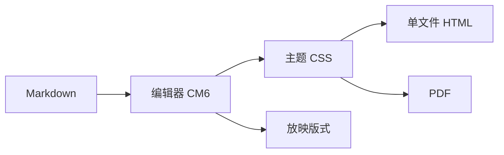

<!-- deck
brand: ColaMD
title: ColaMD 2.7 主题预览
meta: 2026.11 · 幻灯片版式
-->

---

<!-- slide: cover -->

# ColaMD 2.7

## 让每一份文档都有版式

一次编写，两种呈现：同一份 Markdown 既是可检索的文档，也是可直接放映的幻灯片。

---

<!-- slide: section
kicker: Act I
label: 为什么是 2.7
chapter: 章节
-->

## 从「能读」到「好讲」

一套主题、两种形态，版式由内容结构决定，而不是靠手工拖拽。

---

<!-- slide: agenda
kicker: Overview
label: 今日议程
chapter: Act I
-->

## 今天聊四件事

1. **主题体系** 从配色、字体到版式的一体化描述
2. **版式引擎** 11 种版式按内容结构自动匹配
3. **导出链路** HTML、PDF 与放映三端一致
4. **生态与分发** 主题的提取、校验与复用

---

<!-- slide: kpi
kicker: Executive Summary
label: 核心数据
chapter: Act II
-->

## 几个关键数字

- **11 种** 内置版式覆盖绝大多数汇报场景
- **20 个** 活变量构成主题契约的全部接口
- **3 种** 载体共用同一套版式：文档、HTML、PDF
- **1 个** CSS 文件即可完整描述一套品牌主题

---

<!-- slide: timeline
kicker: Milestone
label: 版本演进
chapter: Act II
-->

## 一路走来

- **2023 年** 编辑器内核迁移到 CodeMirror 6
- **2024 年** 主题契约收敛为 20 个活变量
- **2025 年** 加入图表引擎 Pele 与主题提取器
- **2026 年** 2.7.13 幻灯片版式正式上线

---

<!-- slide: steps
kicker: Workflow
label: 四步成稿
chapter: Act III
-->

## 从 Markdown 到放映

1. **写内容** 用 Markdown 记录结构，不操心样式
2. **选主题** 使用内置主题，或从网页、DOCX、PDF 提取品牌样式
3. **定版式** 页首指令声明版式，未声明则走默认文章版式
4. **导出** 输出单文件 HTML 或 PDF，也可直接在应用内放映

---

<!-- slide: matrix
kicker: Capability
label: 能力矩阵
chapter: Act III
-->

## 主题能做什么

- **提取** 从 URL、HTML、DOCX、PDF 还原配色、字体与版式
- **校验** 契约、对比度、色相轴与明度序逐项检查
- **导出** 单文件 HTML 与 A4 / Letter PDF
- **复用** 主题注册后一条命令套用到全部文档
- **扩展** 覆盖 `:root` 变量即可微调，无需改动渲染器
- **分发** 主题包就是一个 CSS 文件，随仓库版本管理

---

<!-- slide: two-col
kicker: Argument
label: 写作与放映
chapter: Act III
-->

## 一份源文件

结构清晰、可检索、可 diff 的纯文本，天然适合版本管理与多人协作。

## 两种呈现

文档视图保留完整语义；放映视图按页切分，版式由标题、列表、图表等结构推断。

---

<!-- slide: figure
kicker: Architecture
label: 渲染管线
chapter: Act III
-->

## 渲染管线

---

## 附录：默认文章版式

没有声明版式的页面按文档式排版呈现，标题、正文、列表、引用、代码与表格都保留完整语义。

| 版式 | 适用内容 | 页面结构 |
| --- | --- | --- |
| cover | 封面 | 主标题 + 副标题 + 导语 |
| section | 章节页 | 短标题 + 一句说明 |
| agenda | 议程 | 有序列表 |
| kpi | 数据速览 | 数字 + 说明 |
| timeline | 时间线 | 年份 + 事件 |
| steps | 步骤 | 有序列表 |
| matrix | 能力矩阵 | 名称 + 说明 |
| two-col | 双栏 | 两个二级标题 |
| figure | 图表页 | 图片 / Mermaid / 表格 |
| quote | 金句页 | 引用 + 署名 |
| closing | 收页 | 行动清单 |

---

<!-- slide: quote
kicker: Voice
chapter: Act IV
-->

> 好的版式不是装饰，而是把作者已经写好的结构，还给他应有的分量。

— ColaMD 设计手记

---

<!-- slide: closing
kicker: Next
chapter: Act IV
-->

## 现在就开始

- 选一个内置主题，导出你的第一份幻灯
- 用 `to-slides` 把长文拆成可直接放映的页面
- 把品牌色提取成主题，团队共享同一套版式
